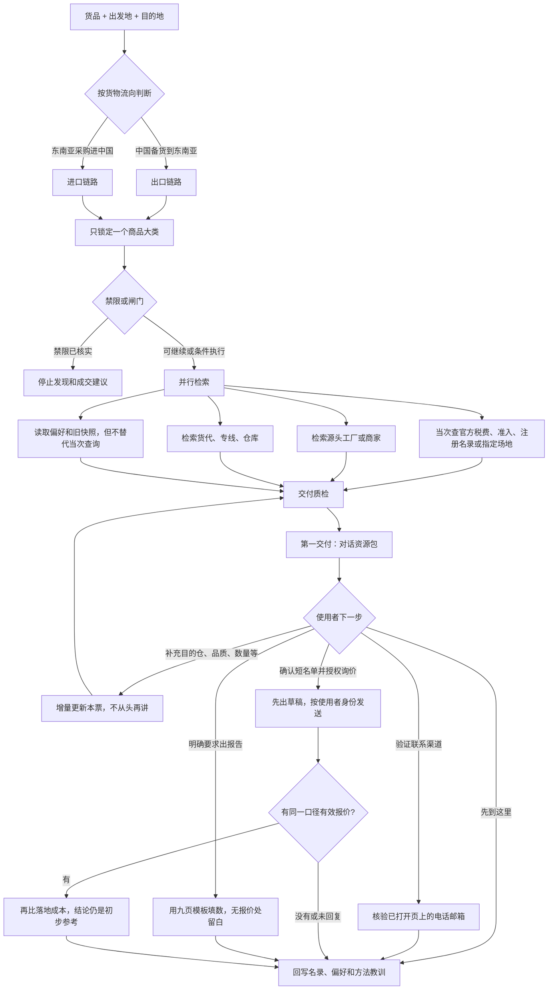

# 操作工作流

本文件是按 `SKILL.md` 和实际开票方式整理的操作工作流。它说明一票任务怎么开始、先交什么、什么时候才能询价或出报告。正文规则以 `SKILL.md` 为准；两者不一致时，以 skill 为准。

## 免责声明

本项目只提供供应链方向的初步参考信息，包括可核对的资源线索、官方公开信息和方案候选。它不构成法律、海关、税务、投资或交易建议，也不在实际商业场景中提供任何确定性结论。是否成交、如何签约、如何报关订舱，以及最终成本与能否放行，须以官方当期规定、有效报价和有资质机构的意见为准。本项目不代替货代报价、海关预裁定、订舱或报关。

## 开工条件

最低输入是这三项：货品（或图、规格）、出发地、目的地。有这三项就启动，不要先追问一长串询价包再动手。

数量、交期、预算、销售渠道、品质要求、是否带电、是否要 Logo 等，有就用，没有不卡住，缺口写进资源包。地理范围仅限中国大陆与新加坡、马来西亚、泰国、印度尼西亚、越南、菲律宾。

方向按货物流向判断，不按口头用词：

- 出口：在中国生产或备货，运往东南亚目的国
- 进口：在东南亚寻找本地工厂或商家，合法运入中国（或使用者明确约定的目的地）

进口和出口是两条独立链路，名单、仓库温层和流程不得混用。

## 主流程

## 第一交付前：并行检索，不要串行等待

锁定一个独立商品大类后立刻并行，不要排成「先分析，再过闸，最后才找公司」。大类互斥，一次只锁一个；对不上现有大类时不得硬塞进「普通货物」。禁限一经核实，停止发现和成交建议，但已查到的官方依据仍应说明。

并行开始时同时做这些事：

1. 读取与本票相关的偏好、本大类本线路名录，以及上次官方快照的日期和来源。名录只作加速起点，必须补做当次公开检索和官方查询。不要为了先读记忆而推迟第一交付。
2. 当次查询官方税则与税费。目的国税费必须带来源和查询日期。优惠税率须注明条件，不得默认零关税。最惠国已是零时，应写明协定不再额外减让。
3. 若本票适用，当次查询官方准入、注册名录或指定监管场地。官方文件下载失败时，改用官方转载、官方查询系统或公开摘录，注明「未取得完整文件」；不得因此把第一交付拖成只交两三家网站，也不得把过期名录写成现行在册。
4. 公开检索并打开源头工厂或商家、货代、专线、快递或仓库的一级页面。不得编造公司或联系方式。电话、邮箱只转录已打开页上明确刊出的，没有就留空。
5. 组装 2–4 条可并行方案，每一条都要挂上具体工厂或商家、以及具体货代或仓库。

出口链路额外注意：不得把中国进口税则中的税率列为本票出口成本。进口链路额外注意：第一交付须写清官方准入依据、指定监管场地的当次查询（如适用）和注册名录截止日期；受注册限制的品类必须同时给出「可直接联系」和注明日期的官方名录候选；使用者要求最高品质或核心产地时，先在可进境名单上按产地、品种、形态过滤，注册不等于品质。

未约定贸易术语时，不得默认门到门包税。页面上的「双清包税」等广告语可以记录，但不得列为方案。不教低报、瞒报或灰色清关，不代办证或报关。

## 交付质检后再交资源包

资源包发出前须按 `SKILL.md` 的交付质检逐项核对。未通过不得把结果写成已完成。

第一交付必须在对话里一次交清：

- 方向与大类
- 已核实税费，带来源和查询日期
- 带可打开 URL 的工厂或商家
- 受注册限制时，注明日期的官方名录候选；联系方式可留空
- 带可打开 URL 的货代或物流
- 挂在具体公司上的方案包
- 缺口与下一步
- 声明：以上内容仅供供应链初步参考，不构成实际商业场景中的确定性结论

公司核实等级只分「仅打开页面 / 执照已核 / 已询到价」。打开页面不等于已核实。没有同一口径有效报价，不得宣布最低落地成本。没有询价数据的位置直接留白或标「待询价」。能做的联系渠道核验可以做，来不及完成时标「联系渠道未核验」，不得因此扣住资源包。

## 第一交付之后：由使用者决定是否继续

询价和方案报告都不是第一交付的前提，也不是默认下一步。资源包交出后等待使用者：

- **补充信息**：中途补上目的城市、口岸、收货仓、品质或数量时，立即锁定到本票并增量更新方案，不要把整条链路从头再讲一遍。
- **验证联系渠道**：只核验已打开页面上刊出的电话或邮箱，不从搜索摘要抄录，不编造。发现问题必须写明。核验通过也不等于对方会接听或回复。
- **授权询价**：须由使用者确认短名单和询价文本。默认先出草稿；确认后再通过使用者本人的通讯工具发出。一次确认只覆盖所点名的对象和这一份文本，不得自动群发。未回复标「待跟进」，不编造报价。
- **生成报告**：只在资源包已经交出、且使用者明确要求时，用 `template/` 中的九页仪表盘模板生成 PPT。没有报价的槽位直接留白。报告也须标明仅供初步参考。
- **先到这里**：使用者未要求询价或报告时，到此为止。

若收回同一口径有效报价，再比较总落地成本、时效和风险。放行建议只能是「继续 / 条件继续 / 停止」；没有有效报价时，写「待询价后再做成交判断」。须在签约前取得的许可证尚未办出时，不得写成「继续」进入签约。上述建议同样只是初步参考。

## 回写与持续优化

每票结束后按三层回写，不要混写：

1. **方法层**：可复用的检索顺序、质检、铁律或链路教训写回 `SKILL.md`，并记入 `CHANGELOG.md`。不要把某次税率、某家工厂或某份报价写进 skill 当永久事实。
2. **偏好层**：清楚的长期习惯（如默认收货城市、品质口径）写入私有记忆。只对「这一票」说的信息，不升为默认。
3. **名录与快照层**：把本次打开且可公开核对的公司写入私有名录，官方快照必须带来源和日期。再次使用时必须复核；官方结论以当次查询为准。

公开仓库只保留方法、模板和文档。不要把私人名录、报价、对话或税则文件提交到本仓库。公开的优化渠道是 Issue 和 Pull Request，规则见 [CONTRIBUTING.md](CONTRIBUTING.md)。
